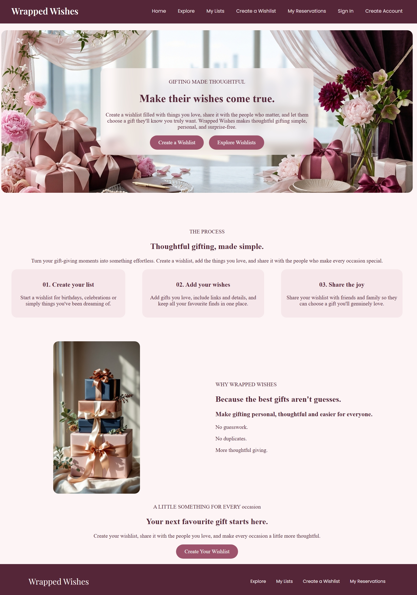

# Wrapped Wishes

**Make their wishes come true.**

Wrapped Wishes is a wishlist platform designed to make gifting more thoughtful and organised. Users can create personalised wishlists, share them with others, explore public wishlists and reserve gifts to avoid duplicate presents.

## Features

- **User Accounts:** Create an account and sign in.
- **Create Wishlists:** Make personalised wishlists for different occasions.
- **My Lists:** View your created wishlists.
- **Explore Wishlists:** Discover wishlists shared by other users.
- **Gift Reservations:** Reserve gifts from other people's wishlists.
- **Unreserve Gifts:** Cancel a reservation when plans change.
- **My Reservations:** Keep track of gifts you have reserved.

## Technologies Used

- HTML5
- CSS3
- JavaScript
- Browser Local Storage

## Getting Started

1. Clone this repository:

  
   git clone https://github.com/sabihaalalji/Wrapped-Wishes.git
   

2. Open the project folder.
3. Open `index.html` in your browser.
4. Create an account and start exploring.

You can also use the Live Server extension in Visual Studio Code to run the project locally.

## Project Structure

Wrapped-Wishes/
│
├── index.html
├── dashboard.html
├── create-wishlist.html
├── explore.html
├── wishlist.html
├── reservations.html
├── sign-in.html
├── create-account.html
│
├── css/
│   └── style.css
│
├── js/
│   ├── main.js
│   ├── dashboard.js
│   ├── wishlist.js
│   ├── explore.js
│   ├── reservations.js
│   ├── signin.js
│   └── create-account.js
│
└── images/

## Data Storage

Wrapped Wishes uses the browser's **Local Storage** to store account information, wishlists and gift reservation details.

The project does not currently use a backend or database. Data is stored locally in the browser.

## screenshot

## Project Purpose

Wrapped Wishes aims to make gift-giving easier, more personal and more enjoyable by helping people share what they wish for while allowing others to choose and reserve gifts thoughtfully.

---

